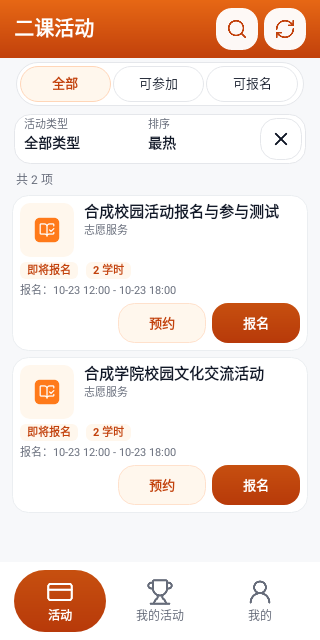
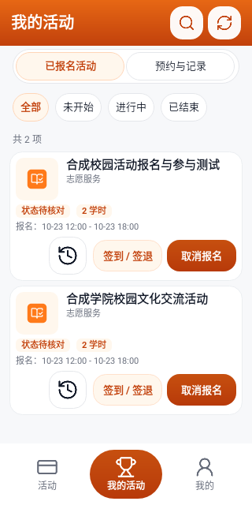
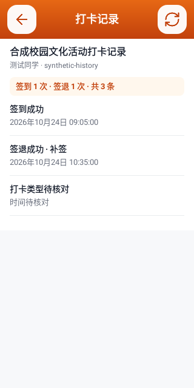

# 第二课堂

山东科技大学第二课堂的非官方 Android 客户端，方便在手机上查询校园活动、报名和管理个人活动。本项目与山东科技大学官方无隶属或授权关系，活动规则与操作结果以学校平台为准。

## 下载

当前版本：**1.0.9**（versionCode 10），支持 **Android 6.0 及以上**。

- [下载第二课堂.apk](https://github.com/lwh041009/sdust-second-classroom/releases/latest/download/%E7%AC%AC%E4%BA%8C%E8%AF%BE%E5%A0%82.apk)
- [查看版本发布与校验文件](https://github.com/lwh041009/sdust-second-classroom/releases/latest)

已安装同签名旧版的用户可直接覆盖安装，保留本机账号和任务，不要先卸载或清除数据。当前为 Android Debug 签名测试包，不是学校官方发布版本。

## 主要用途

- **活动查询**：搜索校园活动，按活动类型、参与资格、报名状态筛选和排序，查看活动详情、时间、地点、学时和报名条件。
- **报名管理**：报名材料预检、人工确认后提交报名，以及取消报名申请。
- **手机本地预约**：提前保存活动和材料，到报名时间由手机重新核验后尝试提交一次，并通过本机通知反馈结果。
- **我的活动**：查看个人已报名活动及状态，查询该活动的签到、签退时间、次数和补签标记。
- **现场签到**：展示学校开放的个人动态/静态二维码，或扫描现场主办方码后由用户确认提交；不提供自动签到或代替现场要求的功能。
- **账号与阅读设置**：多账号本地保存和切换，加密记忆账号密码，会话失效后尝试一次自动登录恢复只读查询，支持字体调整和北京时间校准。
- **学时与分数**：展示学校返回的学时、分数、积分和诚信值摘要，并提供学校官方成绩单入口。

## 使用方法

1. 下载并安装 `第二课堂.apk`，按 Android 系统提示允许本次安装来源。
2. 使用本人的山东科技大学学号/职工号及学校密码登录。当前版本不需要验证码；实际认证要求由学校决定。
3. 在“活动”浏览和报名；在“我的活动”查看已报名活动、预约任务与打卡记录。
4. 使用本地预约前，在设置中检查精确闹钟、通知及电池后台权限，保持网络连接，不要强行停止 App。

## 数据与隐私

- 学校账号认证和业务请求直接连接学校 WebVPN/第二课堂接口，不经过本项目的自建预约服务器。
- 本机保存的账号密码、学校会话、材料和任务使用 Android Keystore 与 AES-GCM 加密；系统备份关闭。
- 删除本机账号会清理其本地凭据，不会删除学校账号或学校报名记录。
- 学校认证、活动查询、报名和签到所需的数据会发送给学校对应接口；版本检查可能连接更新服务或用户配置的备用 HTTPS 地址。
- 本仓库仅分发最终 APK、校验值、界面预览和使用说明，不包含真实账号、Cookie、token、签名私钥、本机配置、学校业务数据或应用源码。

## 使用限制

- **服务器预约尚未启用**，当前仅支持手机本地预约。关机、强行停止、系统省电或网络延迟可能导致预约无法执行，不保证报名成功或获得名额。
- 确认提交的报名、取消报名和签到请求不会自动重放；结果不明时应先核对学校记录，不要重复提交。
- 成果学分的原生分类明细尚未完成，不能将摘要或成绩单入口当成完整原生查询。
- 当前本地合成测试 **88 项通过，Android Lint 0 错误、0 警告**；尚未完成真机全流程及真实学校业务验收。这些测试不代表学校操作成功率或生产可用性保证。
- 请使用本人账号，遵守学校活动规则与现场要求，勿用于批量、恶意或干扰学校服务的操作。

## 界面预览

以下为合成数据生成的原生界面预览，不是真实学校活动或手机实拍。

| 活动列表 | 我的活动 | 打卡记录 |
| --- | --- | --- |
|  |  |  |

## 校验与反馈

`第二课堂.apk` 的 SHA-256：

```text
235d875a3c96b29349cecf88cec4c217428a8e88adc5b38c208fe10762b712fb
```

可在 [Issues](https://github.com/lwh041009/sdust-second-classroom/issues) 反馈问题，请勿上传账号密码、Cookie、token、个人信息或未脱敏的学校业务记录。学校接口变化可能影响使用。

应用图标采用 Lucide BookOpenCheck，相关许可证见 [LUCIDE-LICENSE](LUCIDE-LICENSE)。
